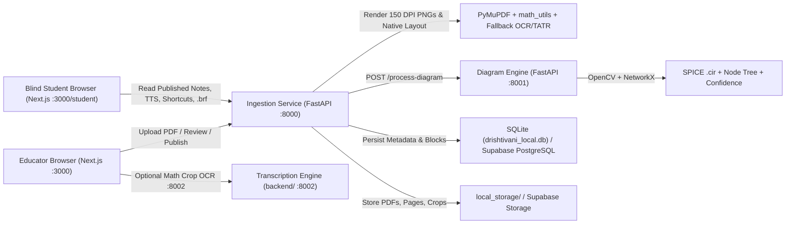

# DrishtiVani — Technical Architecture & Reference

**DrishtiVani** is an accessible multimodal engineering notes platform that converts engineering PDFs (text, headings, lists, tables, equations, and circuit schematics) into teacher-verified, screen-reader-ready study materials with Web Speech audio, MathML, Nemeth Braille (`.brf`), and SPICE netlists (`.cir`).

---

## 1. End-to-End Architecture



### Confidence Gate & Verification Workflow
1. **Upload & Render**: Educator uploads a PDF (`POST /documents` -> `202 Accepted`). PyMuPDF splits pages into 150 DPI PNGs stored in `pages`.
2. **Multimodal Extraction**:
   * **Text / Headings / Lists**: Extracted natively via PyMuPDF font-size tiers (`H1`–`H3`) or fallback OCR.
   * **Tables**: Extracted via `page.find_tables()` (or Table Transformer / OpenCV grid segmentation) into structured `TableGridSchema` rows and semantic HTML5 (`scope="col"`, `scope="row"`).
   * **Equations**: Detected via formula heuristics ([math_utils.py](ingestion-service/app/services/math_utils.py)) or Member 3's `MathEngine`, generating LaTeX, spoken English text, `<math>` MathML, and Nemeth Braille.
   * **Circuit Diagrams**: Vector schematic clusters and images are cropped and processed by Member 2's Diagram Engine into SPICE `.cir` netlists and node-by-node descriptions.
3. **Confidence Gate (`< 0.88`)**: Blocks below threshold (or diagrams with unconnected pins / dangling wires) are flagged `needs_review = true`.
4. **Teacher-in-the-Loop Console (`/teacher/review`)**: Split-pane inspection with bounding boxes, text & netlist editing, per-block and full-page Web Speech audio preview, and one-click **Publish for students**.
5. **Student Accessible Portal (`/student/study`)**: Keyboard-first reader (`↑`/`↓`/`J`/`K`, `H`, `E`, `D`, `R`, `Esc`), `aria-live="polite"` announcements, Web Speech TTS, node-by-node circuit explorer, SPICE netlist view, and `.brf` Braille download.

---

## 2. Tech Stack & Service Map

| Module | Directory | Runtime / Port | Core Libraries |
| :--- | :--- | :--- | :--- |
| **Member 1: Ingestion Service** | [ingestion-service/](ingestion-service/app/main.py) | Python 3.14 (`venv`), `:8000` | FastAPI, SQLAlchemy 2.0, Alembic, PyMuPDF (`pymupdf`), Pillow, `surya-ocr`, `transformers`, `torch`, `httpx`, `psycopg`, `supabase` |
| **Member 2: Diagram Engine** | [diagram_engine/](diagram_engine/api.py) | Python 3.14, `:8001` | FastAPI, OpenCV (`opencv-python`, `opencv-contrib-python`), NumPy, NetworkX, Ultralytics YOLO11, Pillow |
| **Member 3: Transcription Service** | [backend/](backend/app/main.py) | Python, `:8002` *(optional)* | FastAPI, `pix2tex`, `latex2mathml`, `louis` (Liblouis), BeautifulSoup4, Pillow |
| **Member 4: Web Portal** | [frontend/](frontend/package.json) | Next.js `16.4.0` (Turbopack), `:3000` | React `19.3.0`, TypeScript `5`, Tailwind CSS `4`, ESLint `9`, Web Speech API |

---

## 3. Database Schema & Storage (`ingestion-service/`)

Defined in [ingestion-service/app/db/models.py](ingestion-service/app/db/models.py) using SQLAlchemy 2.0, supporting both Supabase PostgreSQL (via [alembic/](ingestion-service/alembic/env.py)) and zero-config local SQLite (`drishtivani_local.db`).

### Tables
* **`documents` (`Document`)**
  * `id` (`UUID`, PK), `title`, `original_filename`, `storage_path`, `page_count`
  * `status`: `uploaded` → `processing` → `parsed` / `failed` → `published`
  * `error_message`, `created_at`, `updated_at`
* **`pages` (`Page`)**
  * `id` (`UUID`, PK), `document_id` (`FK -> documents.id`, cascade delete), `page_number` (unique per document)
  * `width_px`, `height_px`, `dpi` (default `150`), `image_path`, `created_at`
* **`blocks` (`Block`)**
  * `id` (`UUID`, PK), `page_id` (`FK -> pages.id`, cascade delete), `reading_order`
  * `block_type` (`BlockType`): `heading_h1`, `heading_h2`, `heading_h3`, `text`, `equation`, `table`, `diagram`, `figure_caption`, `list_item`, `other`
  * **Pixel Traceability**: `bbox_x0`, `bbox_y0`, `bbox_x1`, `bbox_y1` (in rendered page image pixels)
  * `text`, `crop_path`, `layout_confidence`, `ocr_confidence`
  * **Verification**: `needs_review` (`Boolean`), `verification_status` (`pending` | `approved` | `edited` | `rejected`), `verified_by`, `verified_at`
  * **`extra` (`JSON` / `JSONB`)**: Stores `heading_level`, `table` (`TableGridSchema`), `math` (`latex`, `spoken_text`, `mathml`, `nemeth`), and diagram metadata (`circuit_netlist`, `circuit_summary`, `diagram_confidence`, `circuit_nodes`)

### Storage Buckets
Managed by `StorageService` (local directory `ingestion-service/local_storage/` when `USE_LOCAL_STORAGE=true`, or Supabase Storage):
* `handouts/` — raw PDFs
* `pages/` — rendered page PNGs (`{doc_id}/page_{n}.png`)
* `crops/` — cropped diagram and equation PNGs (`{doc_id}/crops/{block_id}.png`)

---

## 4. Module-by-Module Technical Reference

### A. Document Ingestion Service (`ingestion-service/`)
* **Settings & Mode**: [app/config.py](ingestion-service/app/config.py) reads `.env` (`USE_LOCAL_STORAGE=true`, `SKIP_STARTUP_CHECKS=true`, `DATABASE_URL=sqlite:///./drishtivani_local.db`, `RENDER_DPI=150`, `CONFIDENCE_THRESHOLD=0.80`).
* **PDF Service**: [pdf_service.py](ingestion-service/app/services/pdf_service.py) streams PDF pages via PyMuPDF (`get_pixmap(dpi=150)`) and optimizes PNGs with Pillow.
* **Layout & Extraction**: [layout_service.py](ingestion-service/app/services/layout_service.py)
  * **PyMuPDF Native Pipeline** (`_pymupdf_extract_blocks`): When selectable text exists on a PDF page, extracts tables (`page.find_tables()`), schematic clusters & embedded images (`page.cluster_drawings()`, `get_image_info()`), `H1`–`H3` headings by font-size ratio vs. median size, bullet lists, and equations ([math_utils.py](ingestion-service/app/services/math_utils.py)).
  * **Image / Scanned Fallback**: Uses Surya (`LayoutPredictor` / `RecognitionPredictor` when `llama-server` is available), TATR (`TableService`), or OpenCV row-projection heuristics (`_heuristic_fallback_layout`).
* **Pipeline Orchestration**: [pipeline.py](ingestion-service/app/services/pipeline.py) executes page rendering, layout detection, crop uploads, local or HTTP (`http://127.0.0.1:8001/process-diagram`) diagram analysis, and DB persistence.
* **REST Endpoints**:
  * `GET /health` — database and storage health
  * `GET /documents` — list uploaded handouts with block and flagged counts
  * `POST /documents` — upload PDF (`202 Accepted` + background task)
  * `GET /documents/{id}` — document status and page count
  * `GET /documents/{id}/layout` — full document pages, image URLs, blocks, tables, math, and circuit data
  * `GET /documents/{id}/pages/{n}/blocks` — single-page block list
  * `PATCH /blocks/{id}/verification` — persist `verification_status`, `corrected_text`, and `corrected_netlist`
  * `POST /documents/{id}/publish` — set document `status = "published"` and approve pending blocks

### B. Circuit Diagram Engine (`diagram_engine/`)
* **Component & Pin Detection** — [detector.py](diagram_engine/detector.py):
  * Supports explicit `initial_detections`, YOLO11 (`yolo11s.pt` when local weights exist), and an OpenCV geometric fallback (`_fallback_cv_detect`) classifying:
    * `voltage_source` (unequal vertical parallel plate pairs)
    * `resistor` (wire-connected zigzag strokes)
    * `diode` (enclosed triangle contours)
    * `transistor_bjt` (circular contours split by vertical/horizontal leads)
  * `estimate_terminal_pins()` assigns typed boundary pins (`positive`/`negative`, `pin_1`/`pin_2`, `base`/`collector`/`emitter`, `ground`, `in_inverting`/`in_non_inverting`/`output`).
* **Wire Tracing & Junction Classification** — [wire_tracer.py](diagram_engine/wire_tracer.py):
  * `preprocess_and_mask()` removes component interiors while preserving boundary pins.
  * `skeletonize()` thins wires to 1-px traces.
  * `classify_junctions()` uses an 8-neighbor kernel to classify `ENDPOINT` (`deg=1`), `WIRE` (`deg=2`), `T_JUNCTION` (`deg=3`), `CROSSING_CONNECTED` (`deg>=4` with solder dot fill `>= 0.55`), and `CROSSING_INSULATED` (`deg>=4` without solder dot).
* **Graph Netlist & Confidence Gate** — [graph_netlist.py](diagram_engine/graph_netlist.py):
  * `CircuitGraphNetlist` snaps pins to wire endpoints (`snap_threshold_px=15.0`), assembles an undirected NetworkX graph, assigns equipotential nodes (`0` for ground/negative reference, `n1`, `n2`, ...), synthesizes SPICE `.cir` netlists, and writes node-by-node descriptions.
  * Subtracts `0.15` per unconnected terminal or dangling wire endpoint and flags `needs_teacher_review = True` if `confidence_score < 0.88` or 0 components are detected.
* **Diagnostics & API** — [visualizer.py](diagram_engine/visualizer.py) & [api.py](diagram_engine/api.py):
  * Endpoints: `GET /health`, `POST /process-diagram`, and `GET /ui`.

### C. Math, Table & Braille Transcription (`backend/`)
* FastAPI app ([backend/app/main.py](backend/app/main.py), [transcription_routes.py](backend/app/api/transcription_routes.py)):
  * `POST /api/v1/transcription/process-math-crop` — [math_engine.py](backend/app/engines/transcription/math_engine.py) (`pix2tex` + `latex2mathml` + `louis`)
  * `POST /api/v1/transcription/process-table` — [table_engine.py](backend/app/engines/transcription/table_engine.py) (HTML5 table with `scope="col"` / `scope="row"`)
  * `POST /api/v1/transcription/export-brf` — [braille_exporter.py](backend/app/engines/transcription/braille_exporter.py) (`.brf` export)

### D. Next.js Web Application (`frontend/`)
* **API Client & Modes** — [frontend/lib/api-client.ts](frontend/lib/api-client.ts):
  * **Live Mode** (`NEXT_PUBLIC_DEMO_MODE=false` in `frontend/.env.local`): connects to `NEXT_PUBLIC_API_URL` (`:8000`), `NEXT_PUBLIC_DIAGRAM_API_URL` (`:8001`), and `NEXT_PUBLIC_TRANSCRIPTION_API_URL` (`:8002`).
  * **Demo Mode** (default when `frontend/.env.local` is absent): uses `INITIAL_MOCK_DOCUMENTS` stored in `localStorage`.
* **Routes & Key Components**:
  * `/` ([app/page.tsx](frontend/app/page.tsx)) — Landing page with skip link & `ReadAloudButton`
  * `/choose-role` ([app/choose-role/page.tsx](frontend/app/choose-role/page.tsx)) & `/login` ([app/login/page.tsx](frontend/app/login/page.tsx))
  * `/teacher` ([app/teacher/page.tsx](frontend/app/teacher/page.tsx)) — `DocumentUploadCard`, `DocumentQueueList`, `TeacherStatsGrid`
  * `/teacher/review` ([app/teacher/review/page.tsx](frontend/app/teacher/review/page.tsx)) — Split-pane review (`PagePreviewCanvas`, `ExtractedBlocksPanel`, `BlockEditorControls` with SPICE netlist editor, circuit node breakdown, per-block & full-page Web Speech preview, Approve/Edit/Reject, and Publish)
  * `/student` ([app/student/page.tsx](frontend/app/student/page.tsx)) & `/student/study` ([app/student/study/page.tsx](frontend/app/student/study/page.tsx)) — `AccessibleDocumentReader` (`aria-live="polite"`, `↑`/`↓`/`J`/`K`/`H`/`E`/`D`/`R`/`Esc` shortcuts, MathML, HTML5 tables, node-by-node circuit breakdown, SPICE `.cir`, `.brf` download)
* **Shared Audio Formatting** — [frontend/lib/speech.ts](frontend/lib/speech.ts) (`getSpeakableText` + math operator normalization).

---

## 5. CI/CD & Testing

* **GitHub Actions** ([.github/workflows/ci.yml](.github/workflows/ci.yml)):
  * `frontend-check`: `windows-latest`, `working-directory: ./frontend`, runs `npm ci`, `npm run lint`, and `npm run build`.
  * `backend-check`: `windows-latest`, Python 3.11, runs `flake8` and `pytest -v`.
* **Diagram Engine Tests** ([tests/](tests/)): `test_api.py`, `test_detector.py`, `test_wire_tracer.py`, `test_graph_netlist.py`.
* **Ingestion Service Tests** ([ingestion-service/tests/](ingestion-service/tests/)): config, models, PDF rendering, layout detection, OCR fallback, table structure, storage service, pipeline integration, and FastAPI routes.

---

## 6. Local Setup & Run Commands

### 1. Start Document Ingestion Service (`:8000`)
```powershell
cd ingestion-service
.\venv\Scripts\python.exe -m uvicorn app.main:app --host 127.0.0.1 --port 8000
```

### 2. Start Circuit Diagram Engine (`:8001`)
```powershell
python -m uvicorn diagram_engine.api:app --host 127.0.0.1 --port 8001
```

### 3. Start Next.js Frontend (`:3000`)
Create `frontend/.env.local` for live backend mode (omit to run in local Demo Mode):
```env
NEXT_PUBLIC_DEMO_MODE=false
NEXT_PUBLIC_API_URL=http://localhost:8000
NEXT_PUBLIC_DIAGRAM_API_URL=http://localhost:8001
NEXT_PUBLIC_TRANSCRIPTION_API_URL=http://localhost:8002
```
Then run:
```powershell
cd frontend
npm run dev -- -p 3000
```

### 4. Optional: Start Member 3 Transcription Service (`:8002`)
```powershell
pip install -r backend/requirements.txt
python -m uvicorn backend.app.main:app --host 127.0.0.1 --port 8002
```
